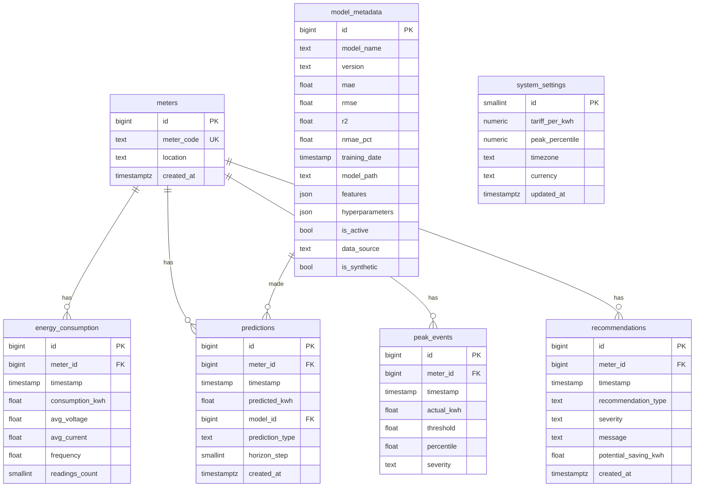

# Database

PostgreSQL 17 holds **application data** (clean hourly data, model results, peaks, recommendations, settings) —
not the raw 6.6M-row CSV (see [ARCHITECTURE.md §3–4](ARCHITECTURE.md)). Code: `database/`.

## Entity-relationship diagram



## Design decisions

| Decision | Reason |
|---|---|
| `bigint` identity primary keys | no overflow risk; standard modern PostgreSQL |
| `energy_consumption` stores **complete hours only** | missing hours are simply absent, never stored as 0 |
| `UNIQUE (meter_id, timestamp)` on consumption and peak events | prevents duplicates; doubles as the composite `(meter_id, timestamp)` index and the FK index |
| Extra indexes: `energy_consumption(timestamp)`, `predictions(meter_id, timestamp)`, `predictions(model_id)`, `recommendations(meter_id, created_at)` | every foreign key indexed (PostgreSQL does not do this automatically); match the API's filters |
| `NUMERIC` for tariff, `double precision` for measurements | exact money arithmetic; measurements are approximate anyway |
| CHECK constraints | non-negative kWh and tariff, valid severity / prediction type, percentile 50–<100, single settings row |
| `timestamp` (no time zone) for readings | the CEEW data has no UTC offset; storing local time plus `system_settings.timezone` is honest. A real-time IoT version should switch to `timestamptz` |
| `ON DELETE CASCADE` from `meters` | removing a meter removes its dependent rows |
| No partitioning | ~331k consumption rows is small for PostgreSQL |

## Migrations (Alembic)

```bash
alembic upgrade head                                   # apply all migrations
alembic revision --autogenerate -m "describe change"   # after editing database/models.py
alembic downgrade -1                                   # undo the last migration
```

Initial migration: `database/migrations/versions/*_initial_schema.py` (autogenerated from the ORM models).

## Loading data

`python -m scripts.load_to_db` performs a full refresh (settings are kept): meters → hourly consumption
(bulk insert in 10k-row chunks) → model metadata (all compared models; the best one `is_active`) → back-test
predictions → peak events (current percentile) → history-based recommendations.

Peak events are recomputed automatically when `PUT /settings` changes the percentile.

## Useful checks

```sql
-- Foreign-key columns without an index (should return no rows)
select conrelid::regclass as table_name, a.attname as fk_column
from pg_constraint c
join pg_attribute a on a.attrelid = c.conrelid and a.attnum = any(c.conkey)
where c.contype = 'f'
  and not exists (select 1 from pg_index i where i.indrelid = c.conrelid and a.attnum = any(i.indkey));

select count(*) from energy_consumption;   -- 331,368 with the real data
```
